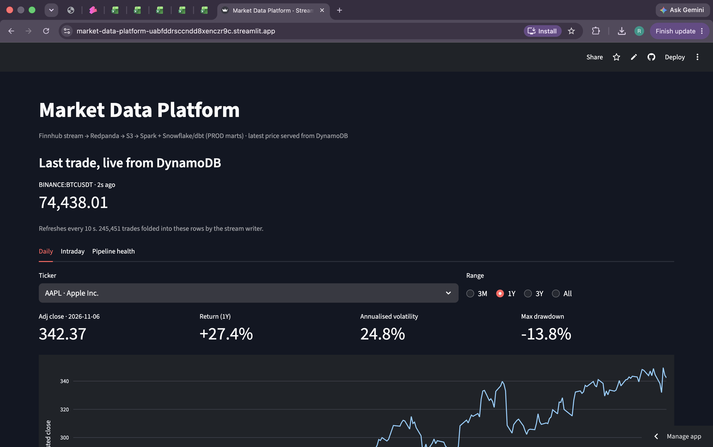
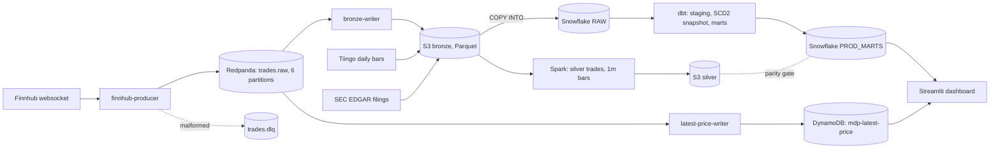
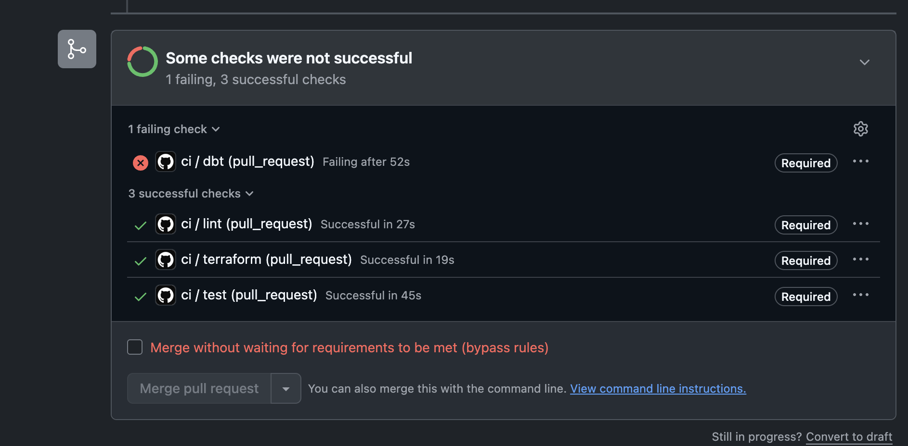

# Market Data Platform

An end-to-end market data platform with streaming and batch paths. Live trades go through Kafka (Redpanda) into an S3 lake, are processed with Spark, and are modeled with dbt into a Snowflake star schema. Airflow orchestrates the batch work, a DynamoDB table serves the latest price per symbol, and GitHub Actions runs CI/CD. All infrastructure is defined in Terraform.

[](https://github.com/rohithjavvadi/market-data-platform/actions/workflows/ci.yml)
[](https://github.com/rohithjavvadi/market-data-platform/actions/workflows/cd.yml)

- **Live dashboard:** https://market-data-platform-uabfddrsccndd8xenczr9c.streamlit.app/
- **dbt docs and lineage:** https://rohithjavvadi.github.io/market-data-platform/



## What it does

- **Streams** live trades from the Finnhub websocket (5 US equities plus BTC/USDT) into Redpanda. Malformed messages go to a dead-letter topic.
- **Lands** raw data in an S3 bronze layer as Parquet. The sources are the trade stream, 5 years of daily bars from Tiingo, and SEC EDGAR company filings.
- **Processes** the lake with PySpark (bronze → silver trades → 1-minute OHLCV bars) and checks the result against the warehouse in an exact parity gate.
- **Models** a star schema in Snowflake with dbt: staging models, an SCD Type 2 security dimension, a date dimension, and two incremental fact tables.
- **Serves** the latest price per symbol from DynamoDB, updated by a second consumer on the same stream.
- **Orchestrates** batch work with Airflow 3, with retries, failure alerts and run deadlines.
- **Tests and ships** every change through GitHub Actions: lint, unit tests, Terraform validation, and dbt "Slim CI" into a throwaway schema for each PR. Merges deploy to PROD.

## Architecture



Airflow runs COPY, dbt, the Spark jobs and the parity gate every 15 minutes during market hours, and runs the Tiingo and EDGAR extracts nightly. The streaming services run continuously in Docker.

| Layer | Tooling |
|---|---|
| Ingestion | Python producers/consumers, Redpanda (Kafka API), confluent-kafka |
| Lake | S3 (bronze/silver Parquet), lifecycle to Standard-IA |
| Processing | PySpark 4 (S3A), dynamic partition overwrite |
| Warehouse | Snowflake (key-pair service users, resource monitor) |
| Modeling | dbt Core, dbt snapshots, dbt-expectations |
| Serving | DynamoDB (NoSQL), Streamlit |
| Orchestration | Airflow 3 (retries, callbacks, Deadline Alerts) |
| Infrastructure | Terraform (AWS + Snowflake providers, S3 state with native locking) |
| CI/CD | GitHub Actions, ruff, sqlfluff, pytest, branch protection |

## Data model


| Model | Type | Grain | Notes |
|---|---|---|---|
| `fct_daily_bars` | Incremental fact | ticker × trading day | Adjusted OHLCV and daily return. Joins `dim_security` point-in-time on the bar date. Merges a 10-day lookback to absorb late Tiingo corrections. |
| `fct_ohlcv_1m` | Incremental fact | symbol × minute | Built from deduplicated trades. Recomputes only bars touched by trades loaded in the last hour, so late data is handled. |
| `dim_security` | SCD Type 2 | ticker × version | From a dbt snapshot of SEC company profiles, unioned with a seed for non-SEC instruments (crypto). Has `valid_from`, `valid_to` and `is_current`. |
| `dim_date` | Dimension | calendar day | 2021–2030. `is_market_day` is derived from actual trading days. |

Trades are deduplicated on `(kafka_partition, kafka_offset)` because the stream is at-least-once. Spark and dbt apply the same rule, and the parity gate checks that both produce identical 1-minute bars on all 7 columns.

## Orchestration

| DAG | Schedule | Tasks |
|---|---|---|
| `mdp_pipeline` | Every 15 min, weekdays 14:00–21:45 UTC | `copy_into_raw` → `dbt_build` + `dbt_source_freshness`; `spark_bronze_to_silver` → `spark_silver_to_bars_1m`; both branches → `bars_parity_check` |
| `mdp_daily_refresh` | 01:15 UTC, Tue–Sat | Tiingo incremental daily bars, SEC EDGAR extract (bronze only) |

- Run dates come from the DAG run (`logical_date`, or `run_after` for manual runs), not the wall clock, so reruns and backfills are reproducible.
- Retries use exponential backoff. An `on_failure_callback` fires after the final retry, and Deadline Alerts fire when a run is still unfinished 20 or 60 minutes after it was queued. Alerts are appended to a log file and can also be sent to a webhook.
- The warehouse pipeline runs only around market hours to stay within the Snowflake credit budget. Ingestion runs around the clock, so the first run each morning picks up overnight data.

<!--  -->

## Data quality and testing

- **74 dbt tests**: `unique`, `not_null`, `relationships` and `accepted_values`, plus dbt-expectations checks for value ranges, OHLC consistency (`high ≥ open/close ≥ low`), row counts and recency. There are freshness checks on all three sources. A failing test fails `dbt_build`, and that fails the Airflow run.
- **Lake/warehouse parity gate**: Spark and Snowflake 1-minute bars must match exactly.
- **22 pytest unit tests**: 17 for the Spark jobs (on fixture data) and 5 for the latest-price consumer logic.

## CI/CD

| Workflow | Trigger | What runs |
|---|---|---|
| `ci` | Pull request, push to `main` | `lint` (ruff, ruff format, sqlfluff), `test` (pytest with Java 17), `terraform` (fmt, validate, with no credentials), `dbt` (PRs only) |
| `cd` | Merge to `main` | `dbt build --target prod`, then publishes dbt docs to GitHub Pages |
| `pr-cleanup` | PR closed | Drops that PR's `PR_<n>_*` Snowflake schemas |

**Slim CI:** each PR builds only the models it changed, plus everything downstream (`state:modified+`), into its own `PR_<n>` schema. Unchanged parents are read from PROD (`--defer`).

**Branch protection:** `main` requires a PR and all four checks to pass.

As a test, a PR that multiplied `daily_return` by 100 (a units bug) was caught by a dbt-expectations range test that failed on 4,127 rows. The merge was blocked.



Terraform `plan`/`apply` deliberately stay manual, so that AWS admin and Snowflake ACCOUNTADMIN credentials never go into GitHub.

## Security

Each component runs as its own least-privilege identity:

| Identity | Scope |
|---|---|
| `LOADER_SVC` (Snowflake) | COPY into `RAW.MARKET` |
| `DBT_SVC` (Snowflake) | Transform role; owns the dev, CI and prod schemas |
| `REPORTER_SVC` (Snowflake) | `SELECT` on `PROD_MARTS` only, including future tables and views; staging is denied |
| `mdp-snowflake-reader` (IAM) | Read-only on the lake buckets, for the Snowflake stages |
| `mdp-ddb-writer` (IAM) | `UpdateItem` on the price table only |
| `mdp-ddb-reader` (IAM) | `GetItem`/`Scan` on the price table only |

All Snowflake users authenticate with key pairs. Only public keys are committed. Secrets live in gitignored env files, Streamlit secrets, and GitHub Actions secrets.

## Metrics

| Metric | Value |
|---|---|
| Daily bars | 1,257 trading days per ticker (5 years), 6,285 rows |
| SEC EDGAR facts | 137,730 rows in staging |
| Trade dedup (2-day Spark window) | 934,018 bronze rows → 932,346 silver rows |
| Stream-to-DynamoDB batching | ~150 trades per write (1,845 messages → 12 conditional upserts), within the free tier |
| `mdp_pipeline` run time | ~2.3 min for all 6 tasks |
| Tests | 74 dbt, 22 pytest |
| One full trading day in S3 | _TBD (2026-11-09)_ |
| Unattended run | _TBD: successful/failed runs over 5 trading days (2026-11-09 to 2026-11-13)_ |

## Cost

| Item | Guardrail | Actual |
|---|---|---|
| AWS (S3, DynamoDB, IAM) | $20/month budget with alerts at $10 and $20; DynamoDB provisioned within the free tier | _TBD_ |
| Snowflake | XS warehouse, 60 s auto-suspend, resource monitor at 25 credits/month | _TBD_ |
| Redpanda, Airflow, Spark | Run locally in Docker or on the host | $0 |
| Streamlit Community Cloud, GitHub Pages | Free tier | $0 |

## Repository layout

```
infra/terraform/       AWS + Snowflake infrastructure (state in S3)
streaming/             docker-compose for Redpanda and the streaming services
producer/              Finnhub websocket → Kafka producer (backoff, validation, DLQ)
consumer/              Kafka → S3 bronze writer; Kafka → DynamoDB latest-price writer
backfill/              Tiingo daily-bar backfill and incremental fetch
edgar/                 SEC EDGAR extractor
spark/                 Bronze→silver, silver→1m bars, parity check
sql/                   Snowflake COPY INTO runner
transform/             dbt project (staging, snapshots, seeds, marts, tests)
orchestration/dags/    Airflow DAGs and shared alerting/retry helpers
dashboard/             Streamlit app, shared queries, snapshot exporter
tests/                 pytest (Spark jobs, consumer logic)
.github/workflows/     ci, cd, pr-cleanup
```

## Run it yourself

Prerequisites: an AWS account, a Snowflake account, free API keys for Finnhub and Tiingo, Docker, Terraform, Python 3.13, and Java 17.

```bash
git clone https://github.com/rohithjavvadi/market-data-platform.git && cd market-data-platform
cp infra/terraform/terraform.tfvars.example infra/terraform/terraform.tfvars    # fill in values
cp infra/terraform/backend.hcl.example infra/terraform/backend.hcl              # state bucket
terraform -chdir=infra/terraform init -backend-config=backend.hcl && terraform -chdir=infra/terraform apply
cp .env.example .env                                                            # MARKET_API_KEY, SEC_USER_AGENT, TIINGO_API_KEY
docker compose -f streaming/docker-compose.yml -f streaming/docker-compose.apps.yml up -d
python backfill/tiingo_daily.py --years 5 && python edgar/edgar_extract.py
source orchestration/airflow.env && airflow standalone                          # unpause mdp_pipeline and mdp_daily_refresh
cd dashboard && streamlit run app.py
```

Snowflake key pairs, the dbt profile and the Streamlit secrets follow the `.example` files in each folder.

## Design decisions

- **Redpanda instead of Apache Kafka** for local development: it uses the same Kafka API in a single container. Messages are keyed by symbol, so each symbol's trades stay ordered within a partition.
- **The bronze writer commits Kafka offsets only after the S3 write succeeds** (at-least-once). Duplicates are removed downstream on `(partition, offset)`.
- **Raw tables are `VARIANT` plus load metadata** for all three sources, so schema changes upstream don't break loading. Typing happens in dbt staging.
- **Lake and warehouse are built independently and must match exactly.** This catches drift in either path.
- **DynamoDB as the serving layer for "latest price".** The writer keeps only the newest trade per symbol in memory and flushes every 5 seconds. Each flush is a conditional write (`trade_ts_ms < :t`), so replays and late messages can never overwrite fresher data.
- **The scheduler builds PROD.** dbt dev is a sandbox; CI builds per-PR schemas; CD and Airflow build PROD.
- **The dashboard falls back to a committed Parquet snapshot** when the warehouse is unreachable, so the public link keeps working after the Snowflake trial ends.

## Known limitations

- The streaming services, Airflow and Spark run on one laptop. Moving to cloud hosting (MSK or Redpanda Cloud, MWAA or Astronomer, EMR Serverless) would mostly be an infrastructure change.
- The Tiingo incremental fetch uses a 7-day window. A split or dividend older than that needs a full re-backfill to refresh adjusted history.
- The EDGAR extract is point-in-time; history is captured from the first snapshot onward.
